# Aegis MFA for Unraid

Two-factor authentication for the Unraid webGUI. After your password, enter a 6-digit code from any authenticator app, or confirm with a passkey. 
Backup codes, a trusted LAN bypass, and lockout protection. It protects root, the only account the Unraid webGUI accepts.

<p align="center">
  &nbsp;
  &nbsp;
  &nbsp;
  &nbsp;
  
</p>

## What it does

Unraid protects the webGUI with a password and nothing else. The usual answer is to put Authelia behind a reverse proxy, which means a container, a subdomain, a certificate, and a configuration file for every service. Aegis MFA is the small answer: install the plugin, scan a QR code, done.

It hooks into the authentication Unraid already has. Every request already passes through an internal gate, and the plugin adds one question to it: this session has the password, has it also passed 2FA? If not, the login page asks for a code instead of sending you to the dashboard. Nothing else about the login changes.

The whole design is built around one rule: a fault must never lock you out. Every failure path in the plugin ends with MFA turning itself off, not with a closed door. There are three independent ways back in even when it is working correctly and you have lost your phone, and a pure-bash floor beneath them for when PHP itself is what broke.

## Features

- TOTP codes: Works with Google Authenticator, Authy, 1Password, Bitwarden, or any RFC 6238 app. No cloud, no push, no account
- Passkeys: Face/fingerprint/PIN or a hardware security key, verified with a from-scratch WebAuthn implementation (ES256 only, no third-party library). Bound to one address you configure, works alongside or instead of an authenticator app - see "Passkeys" below for the address requirement
- Root only: On current Unraid, root is the only account the webGUI login accepts, so root is who enrols, with its own secret and its own backup codes. The plugin does not hardcode root, it reads the account list the same way .login.php does, so it stays correct if that ever changes. Share users appear in the list marked as having no webGUI sign-in, outside the count and without enrolment buttons
- Setup wizard: Scan a QR, confirm a code, save your backup codes. The QR is generated on the server, so the secret never leaves the machine
- Backup codes: Ten single-use codes, shown once. Enrolment does not finish until you type one back, which proves you actually saved them. Re-issuing them later takes the same path, and the codes you already have keep working until you confirm the new ones
- Trusted LAN: Skip the code prompt from networks you trust (IPv4 and IPv6 CIDR). The password is still required, and your browser's address is shown ready to add with one click
- Lockout protection: Too many wrong codes locks the IP out for a while. Counters live in RAM, so however many addresses a brute-force attempt comes from, none of it reaches the boot device
- Lockout history: Blocked addresses with their failure count, when they were locked and how long is left, with a button to release one early. Optionally kept across reboots by a snapshot the ten-minute cron writes, and only when something changed
- Replay protection: A code that has already been used is refused even inside its own 30-second window
- Dry-run: The first 24 hours after you enable it, the login shows the prompt with a skip link and a failed code is logged but not blocked. Confirm it works before it can ever stop you. It runs once per server: enabling again later goes straight to enforcing, and both the confirmation dialog and the notice say so
- Grace period: Until root enrols, the login shows a nudge with a skip, for a configurable window before the setup screen becomes mandatory
- Clock-skew help: A failed code shows the server's own time, which is the usual reason TOTP suddenly stops matching
- Audit trail: Every success and every failure goes to the syslog with the account, the source IP and which credential was used, so a backup code stands out from an app code without opening any file
- Fail-open by design: Corrupt config, a missing file, an Unraid update, an uninstall gone wrong. Every one of them ends with MFA off and password-only login, never with a locked door
- Self-healing: A boot hook and a ten-minute cron re-apply the login patches if an Unraid update removes them
- Watchdog alert: An Unraid notification fires if MFA is on but the login patches are missing, and once more when protection returns
- Ways back in: Backup codes, `aegis-mfa disable` over SSH or the local console, the pure-bash `recover.sh` for when even that will not run, and a `DISABLE.flag` file on a USB boot drive

**Login and setup**

<table>
  <tr>
    <td align="center" width="50%">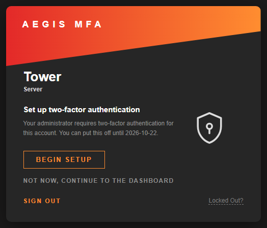<br><sub>Setup reminder during the grace period</sub></td>
    <td align="center" width="50%">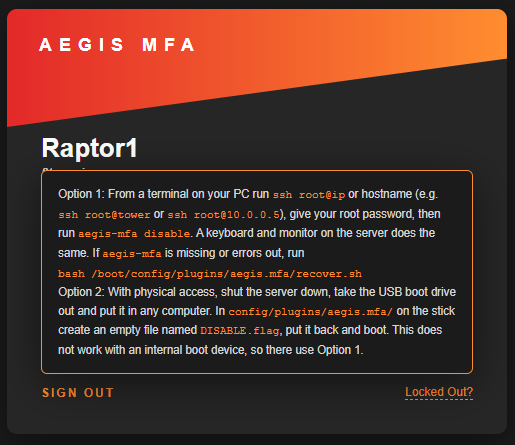<br><sub>The "Locked Out?" help</sub></td>
  </tr>
  <tr>
    <td align="center" width="50%">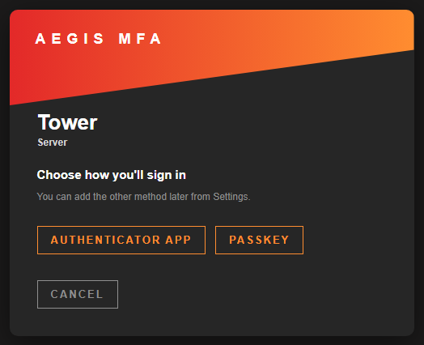<br><sub>Choose an authenticator app or a passkey</sub></td>
    <td align="center" width="50%">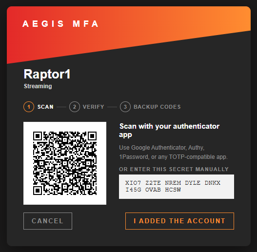<br><sub>Scan the QR code</sub></td>
  </tr>
  <tr>
    <td align="center" width="50%">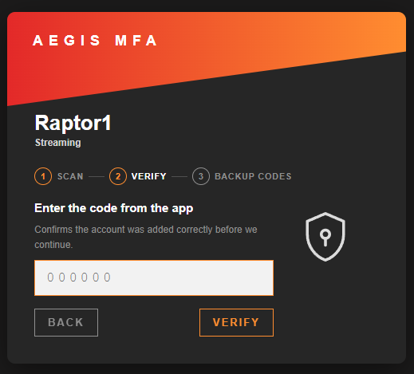<br><sub>Confirm a code from the app</sub></td>
    <td align="center" width="50%">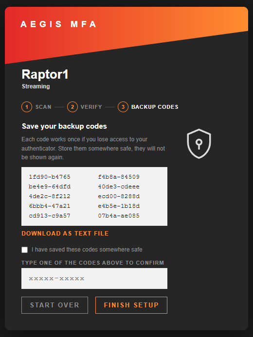<br><sub>Save the backup codes</sub></td>
  </tr>
  <tr>
    <td align="center" width="50%">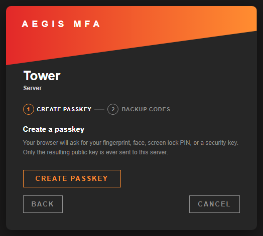<br><sub>Create a passkey</sub></td>
    <td align="center" width="50%">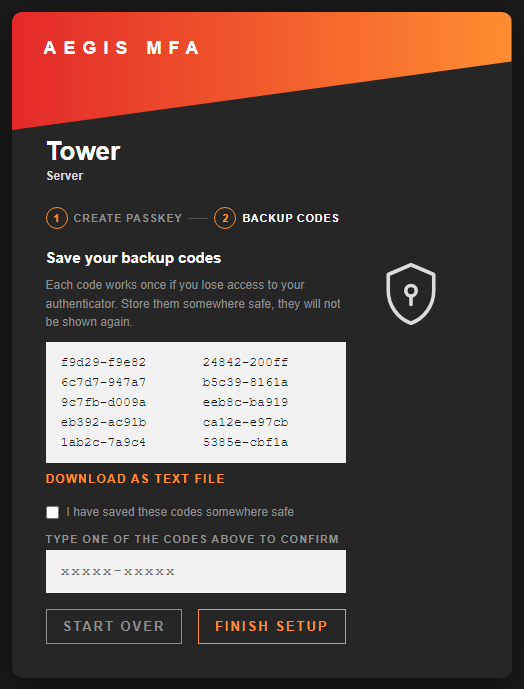<br><sub>Backup codes after a passkey</sub></td>
  </tr>
  <tr>
    <td align="center" width="50%">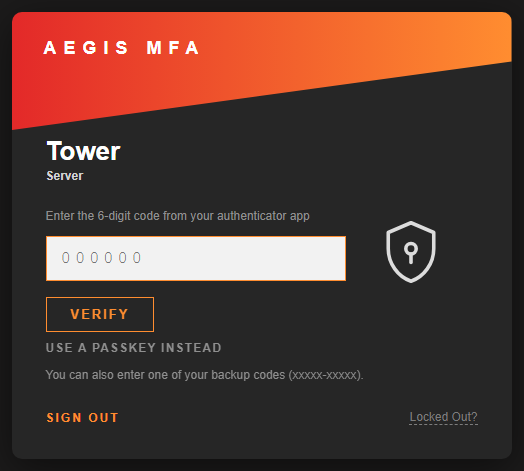<br><sub>The code prompt, with the passkey option</sub></td>
    <td width="50%"></td>
  </tr>
</table>


## How you get back in

This is the part that matters, so it comes before everything else.

**You still have a backup code.** Enter it on the code prompt instead of the 6-digit code. Each one works once.

**You have SSH or the local console.** MFA guards the webGUI only, so SSH still takes just your password: from any computer run `ssh root@tower`, or your server's IP, then `aegis-mfa disable`. A keyboard and monitor on the server does the same. MFA turns off, the login patches are removed, and password-only login is back. Nothing else is touched, and your enrolments are still there when you turn it back on.

**You have physical access and boot from USB.** Shut the server down, put the flash drive in any computer and create an empty file at `config/plugins/aegis.mfa/DISABLE.flag`. On the next boot MFA is off. This one needs nothing but your hands. It does not apply to internal boot, where the boot device is ZFS and will not mount on a desktop; there the console is the way in.

**Even the CLI will not run.** After an Unraid PHP upgrade, in the rare case a plugin file no longer parses, run `bash /boot/config/plugins/aegis.mfa/recover.sh` from that same SSH session or console. It is pure bash with no PHP dependency: it restores the two Unraid login files to stock (from the backups it keeps, or by stripping its own hook if the backups are gone) and sets the disable flag. Your enrolments are left untouched.

The backup code and `aegis-mfa disable` are the everyday paths, the flag on the flash covers a server you can touch but not log into, and the bash script is the floor beneath the CLI, for the one scenario where PHP itself is the thing that broke.

## Scope and limits

Aegis MFA guards the webGUI login and nothing else. SSH, SMB, NFS, and Docker containers are not affected: they never went through the webGUI login in the first place. Second factors are TOTP and passkeys; there is no push notification and no SMS. Secrets, passkey public keys, and backup codes are stored on the boot device, so anyone who can read that device outside the server can read them, which is also true of the passwords already stored there. The trusted LAN bypass is exactly what it says: a request from a trusted subnet skips the code, so it is only as safe as the network you name.

Passkeys need a real HTTPS address: WebAuthn cryptographically binds a credential to one origin, so a passkey only works from the single address you configure (see "Passkeys" below), and browsers refuse WebAuthn entirely over plain HTTP. If you only ever reach the webGUI over a bare LAN IP without a certificate, passkeys are not available to you - the authenticator app and backup codes work everywhere regardless. The verifier supports ES256 (EC/P-256) authenticators only: Apple Touch/Face ID, Android, FIDO2 security keys, and Windows Hello on TPM 2.0 hardware all use it; very old or software-only Windows Hello setups that fall back to RSA are not supported.

## Requirements

- Unraid 7.3.1 or later

The plugin refuses to install below 7.3.1, deliberately. It patches the login path, and the shape of those files on older releases has not been verified. A hard floor is safer than a guess.

## Installation

**Via Community Applications (recommended)**
1. Open Community Applications in Unraid
2. Search for Aegis MFA
3. Click Install

**Manual Installation**
1. Go to Plugins in Unraid
2. Click Install Plugin
3. Paste the following URL and click Install:
   ```
   https://raw.githubusercontent.com/Lazaros-Chalkidis/unraid-aegis-mfa/main/aegis.mfa.plg
   ```

After installing, open Settings > Aegis MFA. MFA is off until you turn it on.

## Uninstalling

Removing the plugin restores the two Unraid login files to stock, turns the saved switch off and
takes its own files with it: the package, `recover.sh`, `DISABLE.flag` and the lockout history.

Your settings and your 2FA enrolments are left in place, because removing a plugin in Unraid is one
click with no confirmation and is more often a reinstall than a goodbye. A reinstall picks them up,
with MFA switched off until you turn it back on:

```
/boot/config/plugins/aegis.mfa/
```

To erase them instead, including the TOTP secrets and the backup codes, remove that folder yourself:

```
rm -rf /boot/config/plugins/aegis.mfa
```

## First run

1. Open Settings > Aegis MFA and click **Enable MFA**. This starts a 24-hour dry-run: codes are checked and failures are logged, but nothing is blocked yet
2. Log out and back in. You will be asked to set up 2FA. Scan the QR with your app, confirm a code, and save your backup codes. With a passkey address configured, the wizard first asks whether you want an authenticator app or a passkey
3. Confirm a normal login works with a code from your app
4. Back in Settings, click **Enforce now**. From here on a missing or wrong code stops the login

The dry-run exists so that a clock problem, a mistyped secret, or an unexpected setup cannot lock you out before you have seen it work once.

## Settings

**Settings > Aegis MFA**

- Enable / Disable: The master switch. Disabling removes the login patches immediately
- Enforce now: End the 24-hour dry-run early, once you have confirmed it works
- Trusted LAN: Networks that skip the code prompt, one CIDR or IP per line, IPv4 and IPv6. The password is still required. When the address you are on is on the list, the page says so at the top, since an exempt browser otherwise looks identical to a protected one
- Grace period: How many days root has to enrol after the first sync before the setup screen becomes mandatory. Two by default, and worth keeping short: while the window is open, anyone with the password can reach the wizard, so enrol as soon as you turn MFA on
- Passkeys: The address (e.g. `https://tower.mydomain.com`) passkeys are bound to, blank by default. Set it to whichever address you use over HTTPS and the setup wizard offers "Passkey" as a method alongside the authenticator app; open the settings page from that same address to add, rename, or remove passkeys per account. Other addresses keep working with the code and backup codes, just not a passkey. If something in front of Unraid terminates HTTPS and forwards plain HTTP to it (Nginx Proxy Manager, Traefik, a Cloudflare Tunnel), tick "Behind an HTTPS-terminating reverse proxy" so the passkey buttons appear; the passkey check itself still verifies the real address your browser reports
- Lockout history: Blocked addresses, with Unlock to release one now, Delete for a spent entry and Clear for every expired one. The Keep history switch controls whether they survive a reboot, nothing else
- Account row: New backup codes, a 2FA reset, or a one-time setup link for when the authenticator is lost. Accounts that cannot sign in to the webGUI have none of these
- Sync accounts: Reconcile the enrolment list against Unraid's own account list. Runs on its own at boot and every ten minutes

The settings page is behind the code prompt like every other page. It carries the Disable button, so a session that has only passed the password does not reach it. If you are locked out, use one of the ways back in described above, none of which goes through the webGUI.

**Settings page**

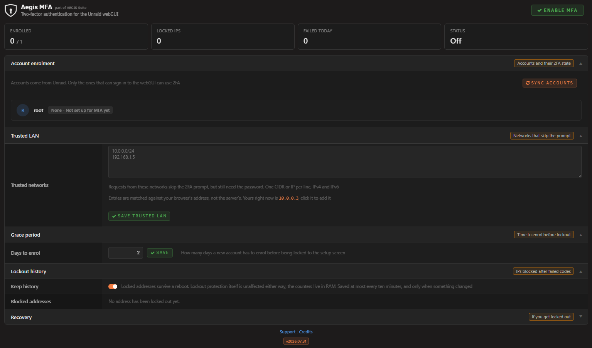

**An account with an authenticator app and a passkey**

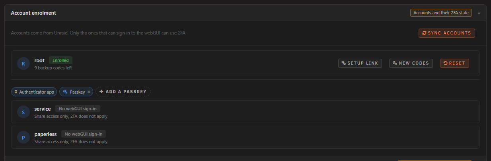

**Adding an authenticator app to a passkey-only account**

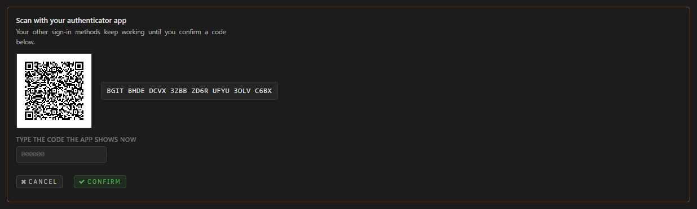

## Command line

The CLI is on the PATH as `aegis-mfa` and works over SSH or the local console:

- `aegis-mfa status` - enabled and enforcing state, patch state, every account's MFA status
- `aegis-mfa enable` / `aegis-mfa disable` - the same switches as the settings page
- `aegis-mfa enforce [now|Nh]` - end the dry-run now, or (re)start one of N hours
- `aegis-mfa preflight` - readiness report before enabling: anchors, lint, a full rehearsal on copies. Live files are never touched
- `aegis-mfa reconcile` - run the boot and cron consistency check right now
- `aegis-mfa users` - every account with the exact rule that lists or skips it, for when something is missing from Sync accounts

## How it works

Unraid already puts every webGUI request through an internal authentication gate (`auth_request` in nginx, answered by `auth-request.php`). The plugin adds one condition to the branch that already decides "this session is logged in": has it also passed 2FA? If not, the gate returns the same 401 Unraid already uses, and nginx sends the browser to the login page, which shows the code prompt instead of the dashboard redirect.

That means two Unraid files carry a small hook: `auth-request.php` and `webGui/include/.login.php`. Both hooks are a dozen lines, and both are written so that any failure at all falls through to Unraid's normal behaviour. If the plugin's own file is missing, if it throws, if it is half-loaded, the request is allowed exactly as it would have been without the plugin. The hooks are bounded by markers, and every write is atomic: the patched copy is built and validated with `php -l` on the side, then swapped into place in one step. A patch that does not compile never reaches the live file, and a vanilla backup sits next to each patched file.

Before either file is touched, its structure is checked: the insertion point must appear exactly once, the file must carry the signatures we expect, and nothing else may have patched it already. A file that fails any of those is left alone and MFA stays off. This is a structural check, not a checksum, which means a new Unraid point release that touches these files cosmetically still works, while a release that genuinely restructures them is refused instead of guessed at.

The patches are re-applied by two independent mechanisms: an event hook at boot and a cron entry every ten minutes. If an Unraid update replaces the login files, the patch is restored automatically. If it replaces them with something we do not recognise, the surviving patch is removed too, so the login is never left half-wired.

Codes are standard TOTP (RFC 6238, SHA1, 6 digits, 30 seconds) with a one-step window either side, which tolerates about thirty seconds of clock drift. A code is compared in constant time, and the step it matched is recorded, so the same code cannot be used twice. Backup codes are bcrypt-hashed and single-use. Secrets and backup codes live on the boot device. The lockout counters live in RAM, so the request path never writes to the boot device at all; the lockout history, when you keep it, is a snapshot the ten-minute cron writes, and only when the set has actually changed.

Passkeys are verified by a WebAuthn implementation written from scratch for this plugin (no Composer, matching the rest of the codebase): a small CBOR decoder, COSE key parsing restricted to EC2/P-256/ES256, and signature verification through PHP's own OpenSSL bindings. Only `authData` is parsed for the credential id and public key; the attestation statement itself (which authenticator manufacturer made the key) is never verified, since trust here is the browser's own WebAuthn UI and the user's gesture, not a device certificate chain. A registration or login is rejected outright if it uses any algorithm other than ES256, if the origin or challenge in `clientData` doesn't match exactly, or if the signature counter fails to increase over what was last stored (guards against a cloned authenticator) - every one of those is a hard fail, same fail-closed rule as the TOTP verifier's "any error denies".

The four passkey endpoints (`webauthn.*.php`) are the only places in this plugin that POST a raw JSON body instead of a normal HTML form. That matters because Unraid's own webGUI carries a second, independent CSRF layer ahead of anything this plugin does: `webGui/include/local_prepend.php` runs as a PHP `auto_prepend_file` before every script on every POST, and terminates the request immediately - silently, with no output at all - unless it finds Unraid's own `csrf_token` (from `state/var.ini`) either as a POST field or as an `X-Csrf-Token` header. A normal `<form method="post">` submission carries that token as a hidden field without anyone having to think about it; a JSON `fetch()` body doesn't touch `$_POST` at all, so the four endpoints send it explicitly as a header instead (see `aegis_mfa_webauthn_js()` in `AegisMfaShell.php`). Any future endpoint that POSTs a non-form body needs to do the same, or it will fail with an empty response that gives no hint why - `tests/requires.test.php` catches a *missing require* for the functions involved, but this native-CSRF requirement is enforced entirely outside this plugin's own code and isn't something a unit test running off this repo alone can see.

## Development

### Requirements
- Unraid 7.3.1 or later (for testing)
- PHP CLI and Bash (for the build script and the test suite)
- Python 3 with zxing-cpp or OpenCV, optional, for the QR decode cross-check
- On Windows specifically: `webauthn.test.php` generates a real EC keypair via `openssl_pkey_new()`, which needs a working `openssl.cnf`. A Windows PHP build (e.g. from scoop) may not find one by default (`openssl_pkey_new()` silently returns `false`) - point `OPENSSL_CONF` at the one PHP ships (`<php install dir>\extras\ssl\openssl.cnf`) before running the tests. Linux PHP, including Unraid's, finds its system one automatically and needs nothing extra

### Build
```bash
./build.sh                  # release build
./build.sh "" dev           # dev build
./build.sh "" local         # local build (embeds .txz in .plg)
```

The build runs the test suite first and refuses to package if anything fails. A plugin that sits in the login path does not ship on a red test run.

### Tests
```bash
./tests/run-all.sh
```

Hundreds of checks across nine suites, none of which need an Unraid box: TOTP against the RFC 6238 and RFC 4226 vectors, WebAuthn (CBOR decoding against RFC 8949 vectors, COSE/ES256 signature verification against a real generated keypair, full registration and assertion ceremonies, sign-count replay rejection), a static require-completeness check that parses every source file's actual `require_once` chain and flags any `aegis_*()` call nothing in that chain defines (the exact bug class a function-level unit test can't see, since the test file supplies its own requires rather than the shipped file's), the helpers (including a real two-process `flock` contention test), the gate's decision matrix and every fail-open path, the installer against throwaway copies of the two Unraid files (patch, rollback, atomicity, simulated OS updates), the enrolment state machine for both methods, the QR encoder, whose output is decoded back with zxing-cpp (OpenCV as the fallback) to prove it actually scans, and the pure-bash recovery script against real patched fixtures.

### Project structure

```
unraid-aegis-mfa/
├── source/
│   ├── include/
│   │   ├── AegisMfaTotp.php      TOTP core (RFC 6238)
│   │   ├── AegisMfaWebauthn.php  WebAuthn/passkey core: CBOR, COSE/ES256, ceremony verification
│   │   ├── AegisMfaHelpers.php   session, JSON+flock, CIDR, users, lockout
│   │   ├── AegisMfaGate.php      aegis_mfa_passed(), the fail-open gate
│   │   ├── AegisMfaInstall.php   the patcher and its safety rails
│   │   ├── AegisMfaEnroll.php    enrolment state machine (TOTP or passkey), CSRF, bypass tokens
│   │   ├── AegisMfaAdmin.php     settings actions, passkey management, the dashboard summary
│   │   ├── AegisMfaQr.php        QR wrapper
│   │   ├── AegisMfaShell.php     the shared login-card shell and WebAuthn JS for the pre-auth pages
│   │   ├── setup.php             the enrolment wizard (served by nginx)
│   │   ├── webauthn.*.php        the four thin JSON endpoints for the browser's WebAuthn ceremonies
│   │   └── vendor/qrcode.php     QR encoder (MIT, Kazuhiko Arase)
│   ├── scripts/
│   │   ├── aegis-mfa             the CLI, symlinked to /usr/local/sbin
│   │   ├── aegis-mfa-cron        the ten-minute consistency check
│   │   └── aegis-mfa-recover.sh  pure-bash recovery, copied to the boot device on install
│   ├── event/
│   │   └── started               boot hook, re-applies the patches
│   ├── images/                   the author and contributor avatars, the plugin mark is inline SVG
│   ├── js/
│   │   └── aegis-mfa-header.js   draws the header icon as line art
│   ├── AegisMfa.page             Settings > Aegis MFA
│   ├── AegisMfaIcon.page         defines the icon class for the Plugins page
│   ├── challenge.view.php        the code prompt
│   ├── aegis-mfa.css             the settings page stylesheet
│   ├── config.default.json       defaults, copied to the boot device on first install
│   ├── README.md                 the short text on the Plugins page
│   └── aegis.mfa.cron
├── tests/
├── screenshots/
├── build.sh
├── CHANGELOG.md
├── ca_profile.xml
├── aegis.mfa.xml
├── aegismfaplugin.svg            the CA catalog icon
├── LICENSE
└── README.md
```

## Issues and support

- GitHub Issues: https://github.com/Lazaros-Chalkidis/unraid-aegis-mfa/issues

## Author

**Lazaros Chalkidis** - https://github.com/Lazaros-Chalkidis

## License

Copyright (C) 2026 Aegis MFA Unraid Plugin - Lazaros Chalkidis

Licensed under the GNU General Public License v3.0 or later (GPL-3.0-or-later). See the `LICENSE` file for the full text.

The bundled QR encoder (`source/include/vendor/qrcode.php`) is Copyright (c) 2009 Kazuhiko Arase and is used under the MIT license.
